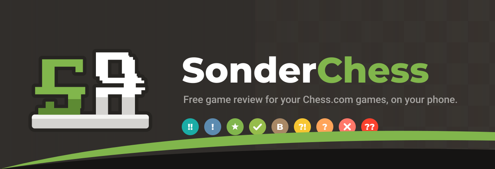

<p align="center">
  
</p>

<p align="center">
  <a href="https://github.com/Verisonder/SonderChess/releases"></a>
  
  
  <a href="LICENSE"></a>
  <a href="https://github.com/Verisonder/SonderChess/actions/workflows/checks.yml"></a>
</p>

<p align="center">
  <b>Free game review for your Chess.com games, on your phone.</b><br>
  Stockfish runs on the device. No account, no subscription, no server.
</p>

---

## What it does

Finish a game on Chess.com, tap the share button and pick **SonderChess**. The app fetches the game, runs Stockfish on your phone and gives you a full review: accuracy, a label for every move, the evaluation graph and the better moves, in a layout that will feel familiar if you know Chess.com's.

Or just open it: give it your Chess.com username once and it shows your profile, ratings and every game you've played, ready to review with a tap.

## Features

| | |
|---|---|
| **Share to review** | Chess.com's share button for live, daily and bot games, a pasted game link, or any PGN. |
| **Game review** | Accuracy for both players, an estimated game rating, the opening's name, the evaluation graph and a count of every move label. |
| **Every move labelled** | Brilliant, Great, Best, Excellent, Good, Book, Inaccuracy, Mistake, Miss or Blunder. The coach says what each move did, an arrow shows the better move and **Best** plays it. **Next** jumps to the next moment that matters. |
| **Your profile** | Ratings, followers, joined date and your full game history from Chess.com's public data, with your own and your opponents' pictures. Works from a username or a shared profile link, and knows which player you are. |
| **Stats** | Rating graphs, win, loss and draw records per time control over 7 days to all time, puzzle ratings, and the brilliant moves from your reviews. |
| **Play** | A game against Stockfish at seven strengths, from beginner to full strength, reviewed when it ends. Or the custom board: move both sides, set up any position, and switch the engine on for its evaluation and best lines. |
| **Puzzles** | Over 46,000 puzzles that work offline, picked at your level, with your own puzzle rating and streak. Plus Chess.com's daily puzzle. Hints, the solution and retry on both. |
| **Make it yours** | 20 boards, 7 piece sets, backgrounds or your own photo, 5 sound sets (with a sound of its own for brilliant moves), coordinates, highlights and animation speed. |
| **Works offline** | Reviews, your profile and your games stay on the phone and update when you're back online. Analysis never needs the internet. |

## Install

Download the APK from the [releases](https://github.com/Verisonder/SonderChess/releases) and open it. Needs Android 8.0 or newer on a 64-bit ARM phone.

## How it is built

```
app/src/main/java/com/verisonder/sonderchess/
  core/     the chess rules, PGN and Chess.com's move format, the move classifier,
            the coach's words (plain Kotlin, tested on the JVM)
  engine/   Stockfish as a child process, spoken to over UCI
  data/     Chess.com's game endpoints and public API, the saved reviews
  ui/       Jetpack Compose screens
tools/      fetch_stockfish.sh, make_sounds.py, make_icon.py, make_banner.py
```

Stockfish is the official Android build, shipped as a native library and run as its own process. Every sound is synthesised by `tools/make_sounds.py`; the icon and this banner are drawn by `tools/make_icon.py` and `tools/make_banner.py`.

### Building

```
tools/fetch_stockfish.sh      # downloads the official Stockfish 17.1 build for Android
gradle testDebugUnitTest assembleDebug
```

## Credits

- [Stockfish](https://stockfishchess.org) (GPL-3.0), the chess engine.
- Chess pieces based on the [RhosGFX](https://github.com/lichess-org/lila/tree/master/public/piece/rhosgfx) set (CC0), recoloured.
- Other piece sets: Classic by Colin M.L. Burnett (GPL-2.0+), Merida by Armando Hernandez Marroquin (GPL-2.0+),
  Chessnut by Alexis Luengas (Apache 2.0), Mono by Maxime Chupin (GPL-3.0+), Spatial by Maurizio Monge (MIT),
  Warm is RhosGFX in its own colours (CC0). All via [lichess-org/lila](https://github.com/lichess-org/lila/blob/master/COPYING.md).
- Opening names from [lichess-org/chess-openings](https://github.com/lichess-org/chess-openings) (CC0).
- Puzzles from the [Lichess puzzle database](https://database.lichess.org/#puzzles) (CC0): 46,345 of the best-rated, about 2,000 per 100 rating points.
- Fonts: Montserrat and Roboto (SIL Open Font License).
- Badge symbols from Google's Material icons (Apache 2.0).

SonderChess is not affiliated with or endorsed by Chess.com.

## License

GPL-3.0. See [LICENSE](LICENSE).
